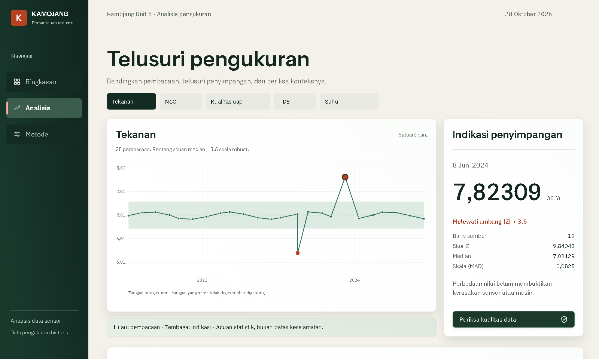

# Kamojang

Historical sensor analysis for geothermal process measurements.

Kamojang is an Indonesian-language web application for inspecting time-series observations, reviewing data quality and identifying statistical deviations. It includes a self-hosted, attributed 3D steam-turbine viewer and an optional local Gaussian Process Regression (GPR) forecasting workflow. The application operates on historical files; it is not connected to field sensors.



The public screenshots and sample data are synthetic. No operational Kamojang measurements are distributed with this repository.

## Project status

**Development:** [draft PR #1](https://github.com/vlnvn/kamojang/pull/1) on `feat/initial-platform`. The project has not been merged, released or deployed publicly. Functional and CI checks have passed at the documented revision; final design approval, real-device testing and project code licensing remain open. See the [verification matrix](docs/testing.md) for dated evidence and limitations.

## What it does

- **Import and validate:** Process CSV and XLSX in a cancellable browser worker; retain source row identifiers, SHA-256 provenance and repeated dates.
- **Inspect measurements:** Explore pressure, temperature, steam quality, non-condensable gases (NCG) and total dissolved solids (TDS) on a continuous time axis, with a keyboard-accessible table and row inspector.
- **Screen deviations:** Recompute retrospective median/MAD scores at thresholds of 3.0, 3.5 or 4.0. Keep quality warnings separate from statistical flags. Export assessments as CSV or JSON.
- **Inspect equipment context:** View an optimized, licensed steam-turbine model with bounded camera controls, keyboard/touch support and a static fallback. The model is representative equipment, not a digital twin of Kamojang Unit 5.
- **Evaluate forecasts:** Optionally run GPR and two forecasting baselines through a Python service bound to localhost. This is a forecasting experiment, not an equipment-failure classifier.

The robust screening workflow works without Python. Uploaded files remain in memory and are discarded on refresh; exports must be protected to the same standard as their source.

## Get started

Verified development environment: Node.js 24.11.0 and npm 11.6.1.

```sh
git clone https://github.com/vlnvn/kamojang.git
cd kamojang
git switch feat/initial-platform
npm ci
npm run dev
```

Open the local URL printed by Vite. The built-in example uses synthetic measurements; it does not require the private research workbook.

To run the optional GPR workflow, install the pinned Python dependencies and launch the combined local frontend and research service:

```sh
python -m pip install -r scripts/requirements-research.txt
npm run dev:research
```

The optional service binds to `127.0.0.1:8341` and only processes measurements after an explicit user action. Do not expose it publicly. Static hosting does not provide this service.

## Architecture

```text
CSV / XLSX
    |
    v
Browser import worker ---> schema, limits and data-quality checks
    |
    v
In-memory measurements ---> median/MAD scoring ---> chart, inspector, export
    |
    +-- explicit request --> loopback Python service --> GPR holdout evaluation

Self-hosted CC BY 4.0 turbine GLB --> lazy Three.js viewer --> static fallback
```

The frontend uses React, TypeScript and Vite. The robust estimator is implemented in TypeScript and verified independently in Python. No account system, database, cloud upload or live telemetry backend is provided. See the [architecture](docs/architecture.md), [data methodology](docs/data-methodology.md) and [ADR 0002](docs/decisions/0002-genuine-viewer-and-local-gpr.md).

## Verification

The recorded development checks include 17 TypeScript tests, 10 Python tests, 22 public browser tests and three actual-service GPR browser tests. CI runs quality/build, browser/accessibility and local-GPR/security jobs. The private-workbook parity check is separate and cannot run in public CI.

```sh
npm run format:check
npm run lint
npm run typecheck
npm test
python -m unittest discover -s scripts -p 'test_*.py' -v
npm run build
npx playwright install chromium
npm run test:e2e
npm run scan
```

These commands do not replace asset licensing review or real-device testing. The most recent documented full-frame Figma comparisons remain outside pixel equivalence, and owner visual approval is pending. Refer to [test evidence](docs/testing.md) and [design fidelity](docs/design-fidelity.md) rather than treating CI success as production certification.

## Documentation

| Topic | Document |
| --- | --- |
| Documentation guide | [Start here](docs/README.md) |
| System boundaries and component responsibilities | [Architecture](docs/architecture.md) |
| Data contract, estimator and reproduction | [Data methodology](docs/data-methodology.md) |
| 3D source, license and modifications | [Asset provenance](docs/asset-provenance.md) |
| Tests, CI evidence and limitations | [Verification matrix](docs/testing.md) |
| Visual regression and Figma comparisons | [Design fidelity](docs/design-fidelity.md) |
| Engineering record (Indonesian) | [Laporan engineering](docs/laporan-engineering.md) |

## Credits and rights

The [Steam Turbine](https://sketchfab.com/3d-models/steam-turbine-bcc264eafbe4412d9c061d6d97f30b99) model is by **landinweaver**, distributed under [CC BY 4.0](https://creativecommons.org/licenses/by/4.0/). The application records attribution and modifications in [asset provenance](docs/asset-provenance.md) and `public/models/LICENSE.txt`. Instrument Sans and IBM Plex Sans use SIL OFL 1.1; font notices are included in `public/licenses/`.

The source workbook, research report, original research archive and measurement-bearing outputs are not published. Permission to run an analysis does not grant permission to redistribute its inputs.

The repository's **code license has not been selected**. Public visibility does not grant reuse rights to the source code. This application has not been validated for safety-critical decisions.

## Contributing and security

See [CONTRIBUTING.md](CONTRIBUTING.md) for changes, tests and review requirements, and [SECURITY.md](SECURITY.md) for vulnerability reporting and handling of sensitive inputs. Maintained by [vlnvn](https://github.com/vlnvn).
